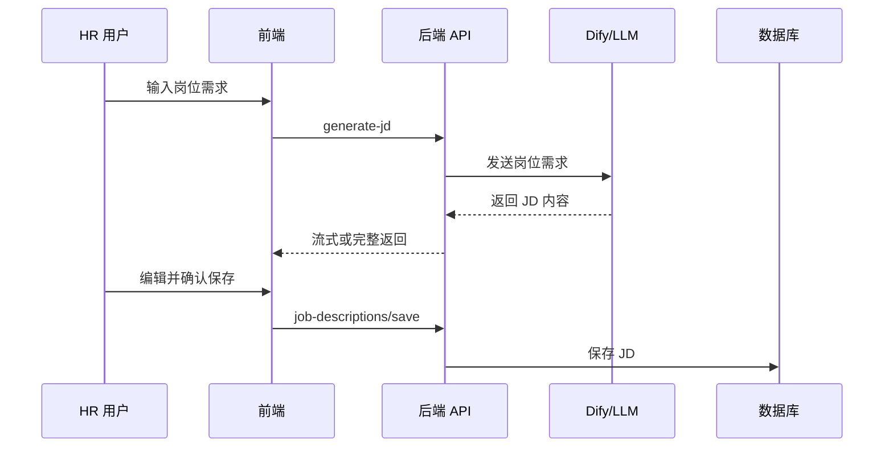
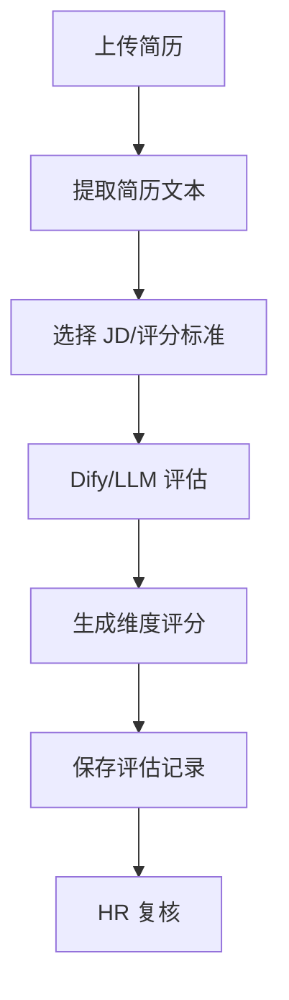
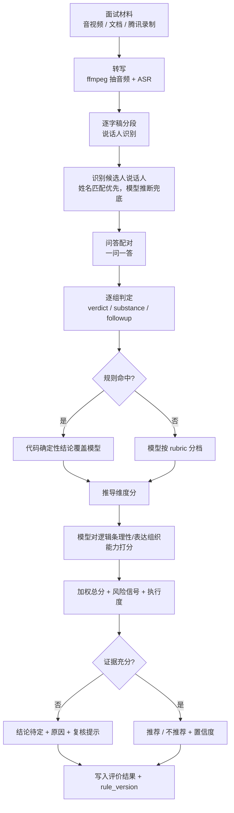
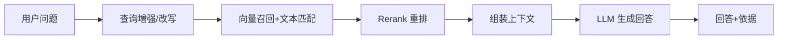

# AI 工作流与质量控制说明

## 1. 文档目的

本文档说明 HR Agent 项目中 AI 能力的使用边界、工作流设计、质量控制、人工审核、失败兜底和验收方法，避免将 AI 输出误解为不可解释或不可控的自动决策。

## 2. AI 能力范围

| 场景 | AI 能力 | 输出 | 人工角色 |
| --- | --- | --- | --- |
| JD 生成 | 根据岗位需求生成职位描述 | JD 初稿 | HR 编辑和确认 |
| 评分标准生成 | 根据 JD 生成评分维度 | 评分标准 | HR 调整权重和维度 |
| 简历评估 | 解析简历并与 JD 匹配 | 总分、维度、理由 | HR 复核 |
| 面试方案 | 根据简历和 JD 生成面试建议 | 问题、重点、评分建议 | 面试官选择和修改 |
| 面试评价 | 转写 + 问答配对 + 规则与 rubric 评分 | 四维评分、证据、风险、结论 | HR 复核并修订 |
| 知识问答 | 基于知识库检索增强回答 | 回答和依据 | 用户判断是否采纳 |
| 试卷生成 | 根据资料生成题目 | 试卷、答案、解析 | 培训管理员审核 |
| Agent 编排 | 识别意图并选择工具 | 步骤、路由、产物 | 用户确认执行 |
| 邮件通知 | 生成草稿或通知内容 | 邮件草稿 | HR 确认发送 |

## 3. AI 边界声明

- AI 结果是辅助产物，不是最终人事决策。
- 简历评分不能直接作为录用或淘汰依据。
- 面试评价是复核工具：结论为「待定」时不得输出录用建议；即使给出「推荐」，也不代表录用决定。
- 面试评价的每个维度必须能指回逐字稿原文，不允许只给分数。
- 转写与说话人识别存在误差，说话人未确认时必须提示并降低置信度。
- 邮件通知不得绕过人工确认自动发送。
- 知识问答在无相关资料时应提示不确定。
- Agent 只能调用系统声明的工具，不能自由执行任意代码或任意外部操作。

## 4. JD 生成工作流

质量要求：

- 岗位名称、职责、任职要求、技能、经验、学历、地点应清晰。
- 内容应避免歧视性或不合规表达。
- 输出应保留 HR 编辑空间。

## 5. 评分标准生成工作流

输入：

- JD 正文
- 岗位标题
- 可选岗位要求结构化信息

输出：

- 总分
- 评分维度
- 每个维度的说明、权重和评分建议

质量要求：

- 维度之和应与总分口径一致。
- 维度应覆盖硬技能、项目经验、行业背景、沟通能力、岗位匹配度等。
- 不能只给总分，必须给评分理由。

## 6. 简历评估工作流

质量要求：

- 评分结果应包括总分、维度分、理由。
- 高匹配简历应明显高于低匹配简历。
- 若简历解析失败，应明确提示，不应生成虚假评分。
- 评估理由应引用简历中的能力、项目或经历。

## 7. 面试方案工作流

输入：

- 简历评估 ID
- 候选人姓名
- 应聘岗位

输出：

- 面试目标
- 面试流程
- 核心问题
- 追问建议
- 风险点
- 评分建议

质量要求：

- 问题应和 JD、简历、评分结果相关。
- 对低分维度应给出追问建议。
- 方案应面向面试官可直接使用，而不是泛泛模板。

## 8. 面试评价工作流（转写 + 评分）

这是当前版本 AI 质量要求最高的一环：既要结论稳定，又要能被人复核。

### 8.1 判定字段

| 字段 | 含义 | 判定方式 | 取值 |
| --- | --- | --- | --- |
| `verdict` | 这段回答有没有回应问题 | 混合：先规则后模型 | 切题 / 部分切题 / 答非所问 / 回避 / 未作答 |
| `substance` | 回答里的信息密度 | 混合 | none / claim / action / data |
| `followup` | 面试官是否深挖 | 模型 | none / surface / deep |

规则文件对每个档位都给出 `criteria`、`requires`、`excludes`、`examples`（hit/miss/ambiguous）与 `precedence`，同字段单选取值、按 precedence 从小到大命中即停。

### 8.2 维度与权重

| 维度 | 权重 | 计分来源 | 说明 |
| --- | --- | --- | --- |
| 问答一致性 | 35% | 规则推导（`verdict` 正向比例） | 可核对 |
| 事实信息量 | 35% | 规则推导（`substance` 均值分档） | 可核对 |
| 逻辑条理性 | 15% | 模型按 rubric | 暂无可复核指标 |
| 表达组织能力 | 15% | 模型按 rubric | 暂无可复核指标 |

补充说明：

- 总分只由 `status=scored` 的维度加权折算，缺失维度权重按比例归一，**不采信模型自报总分**。
- 追问深度不计入候选人得分，而是汇总为「面试执行度」，衡量面试官是否深挖。
- 逻辑条理性与表达组织能力目前只有文字 rubric，规则文件明确标注为 `unscored` 口径待验证，等真实样本相关性验证后再纳入确定性规则。

### 8.3 强制待定条件

| 条件 | 触发原因 | 结果 |
| --- | --- | --- |
| 可评分维度不足（少于阈值） | 大部分问答无法判断 | 结论待定、置信度降低 |
| 转写长度低于阈值 | 录音过短或转写失败 | 结论待定、置信度「低」 |
| 问答配对失败 | 无法建立逐条依据 | 结论待定、置信度「低」 |
| 判定标签缺失比例 ≥ 20% | 输出被截断，只覆盖前半场 | 结论待定并提示复核 |
| 多说话人中找不到候选人标签 | 证据可能落到面试官头上 | 结论待定并提示核对姓名 |

### 8.4 质量要求

- 同一份逐字稿重复分析，结论方向应一致（允许分数小幅波动，不允许推荐/待定翻转）。
- 每个维度的 `evidence` 必须能在逐字稿中定位到原文。
- 不允许出现「候选人没说过的话被当作依据」。
- 说话人是模型推断而非人工确认时，必须在结果中标注并降低置信度。
- 评价必须带 `rule_version`；规则变更后历史结果不重算，重新分析才使用新版本。

### 8.5 人工审核要求

- 分析前：HR 必须确认候选人姓名，避免说话人错位。
- 分析后：HR 至少抽查 3 组问答的判定是否与实际对话一致。
- 修订分数必须填写说明；修订记录进入留痕，不覆盖原始 AI 分数。
- 结论为「待定」的记录，不得直接用于候选人横向比较。

### 8.6 版本与回归

- 规则文件（`app/rules/interview_rules_v1.json`）是档位定义与权重的唯一来源，提示词由它渲染。
- 修改档位定义必须先改规则文件并升 `rule_version`，再回归以下单测：`tests/services/test_interview_rules.py`、`test_derived_scores.py`、`test_qa_pairing.py`、`test_rule_render.py`、`test_candidate_name.py`、`test_manual_scores.py`、`test_speaker_inference.py`、`test_transcript_segmenter.py`。
- 建议保留一份「金标准逐字稿 + 人工标注判定」作为回归基线，规则或模型变更后对比一致率。

## 9. RAG 知识问答工作流

质量要求：

- 对文档内明确事实问题，回答应与原文一致。
- 对文档外问题，应提示没有足够资料。
- 回答应尽量提供来源或依据片段。
- 不应把通用知识伪装成企业文档结论。
- 召回结果低于 `RAG_MIN_SIMILARITY_SCORE` 时不进入上下文；前端不再展示被过滤的低相关「参考来源」。

## 10. 试卷生成工作流

输入：

- 试卷标题
- 科目
- 难度
- 时长
- 总分
- 题型和题量
- 参考资料
- 特殊要求

输出：

- 试卷正文
- 题目列表
- 答案
- 解析

质量要求：

- 题目应来自或围绕参考资料。
- 题型和题量应符合配置。
- 答案和解析应可人工审核。
- 生成后必须允许培训管理员编辑。

## 11. Agent 决策质量

Agent 的决策由「规则快通道 + 受控 ReAct」共同完成，路由本身不执行写操作。需满足以下行为：

| 输入 | 预期行为 |
| --- | --- |
| “你好” | 普通回复，不调用工具 |
| “帮我生成前端工程师 JD” | 识别 `jd` |
| “帮我把刚才那份 JD 的学历要求改成本科” | 识别 `jd_edit`，定位到本轮产物后修改 |
| “评分标准里加一条沟通能力” | 识别 `criteria_edit` |
| “帮我筛选简历”但无附件 | 追问简历文件和 JD |
| 上传简历并说“帮我评分” | 识别 `resume_screening` |
| 上传文档并说“生成试卷” | 识别 `exam_generate` |
| “删除刚才的 JD” | 识别 `resource_delete`，确认后删除并回报名称 |
| “删掉张三的评分记录” | 识别 `resource_delete`，先查到明确对象再删；查不到则追问，不臆造 |
| “给候选人发面试通知” | 生成草稿并要求确认，不直接发送 |
| “把候选人淘汰掉” | 不提供该能力，回复边界并引导到页面操作 |

决策质量要求：

- `mode` 与 `action` 必须自洽（`action=chat` ↔ `mode=chat`）。
- 不确定时选择普通对话而不是工具，宁可少做不可误做。
- 删除/发送类动作必须由确认节点兜底，不能依赖模型自行遵守。
- 指代解析（「刚才那个」）失败时应追问，不得猜测对象。

## 12. AI 质量测试集

建议建立固定测试集：

| 测试集 | 数据 |
| --- | --- |
| JD 测试集 | 前端工程师、后端工程师、AI 产品经理 |
| 简历测试集 | 高匹配、中匹配、低匹配各 1-2 份 |
| 面试测试集 | 3~5 份真实逐字稿（含说话人已标注与未标注各一半），人工标注 verdict 作为金标准 |
| 知识库测试集 | HR 制度、培训资料、岗位说明 |
| 试卷测试集 | 1 份可验证答案的培训资料 |
| Agent 测试集 | 常见指令、模糊指令、高风险指令 |

## 13. 质量评分标准

| 维度 | 评分说明 |
| --- | --- |
| 完整性 | 是否覆盖应有结构和字段 |
| 相关性 | 是否与输入需求、文档、简历相关 |
| 可解释性 | 是否给出理由、依据、维度 |
| 可编辑性 | 是否方便用户修改和保存 |
| 稳定性 | 多次运行结果是否大体一致 |
| 安全性 | 是否避免越权、自动决策和敏感泄露 |

建议验收口径：

- 5 分：可直接使用，仅需少量编辑。
- 4 分：结构完整，需要正常人工修改。
- 3 分：可作为参考，但需要明显重写。
- 2 分：相关性不足，不能进入业务流程。
- 1 分：错误、虚构或存在安全风险。

P0 场景建议平均分不低于 4 分，且不得出现 1 分安全风险样例。

## 14. 失败兜底

| 失败类型 | 处理 |
| --- | --- |
| 模型超时 | 提示重试，保留输入 |
| Dify 工作流失败 | 展示失败步骤和错误摘要 |
| 文档解析失败 | 提示格式问题，允许重新上传 |
| Embedding 失败 | 文档标记处理失败，不进入知识问答 |
| Rerank 失败 | 降级为原始召回排序 |
| Agent 意图不确定 | 普通回复或追问，不误触发工具 |
| 邮箱发送失败 | 返回连接或认证错误，不重复发送 |
| 腾讯会议 Token 失效 | 建会失败并提示重新获取 Token，不生成假会议号 |
| 转写为空或 ffmpeg 缺失 | 面试记录标记 failed，保留原文件，允许重传 |
| 问答配对失败 | 评价照常产出但强制「待定」并说明原因 |
| 判定标签大面积缺失 | 强制「待定」并提示复核，不输出强结论 |

## 15. 人工审核要求

- JD：HR 确认后保存或发布。
- 评分标准：HR 确认维度和权重。
- 简历评分：HR 复核总分和理由。
- 面试方案：面试官确认问题和流程。
- 面试评价：HR 确认候选人姓名、抽查问答判定、必要时修订分数并填写说明。
- 试卷：培训管理员确认题目、答案和解析。
- 邮件：发送前必须确认收件人、主题和正文。

## 16. 生产化改进建议

- 增加 Prompt 版本管理；面试评分规则已用 `rule_version` 管理，其他提示词建议对齐同一机制。
- 增加 AI 输出采纳率统计。
- 增加人工修改前后差异统计；面试评价已有修订留痕，可直接统计修订率。
- 增加模型调用日志和成本统计（含 Agent 路由与面试分析的 Token 消耗）。
- 增加敏感词和合规表达检查。
- 增加简历与面试材料的脱敏和访问审计。
